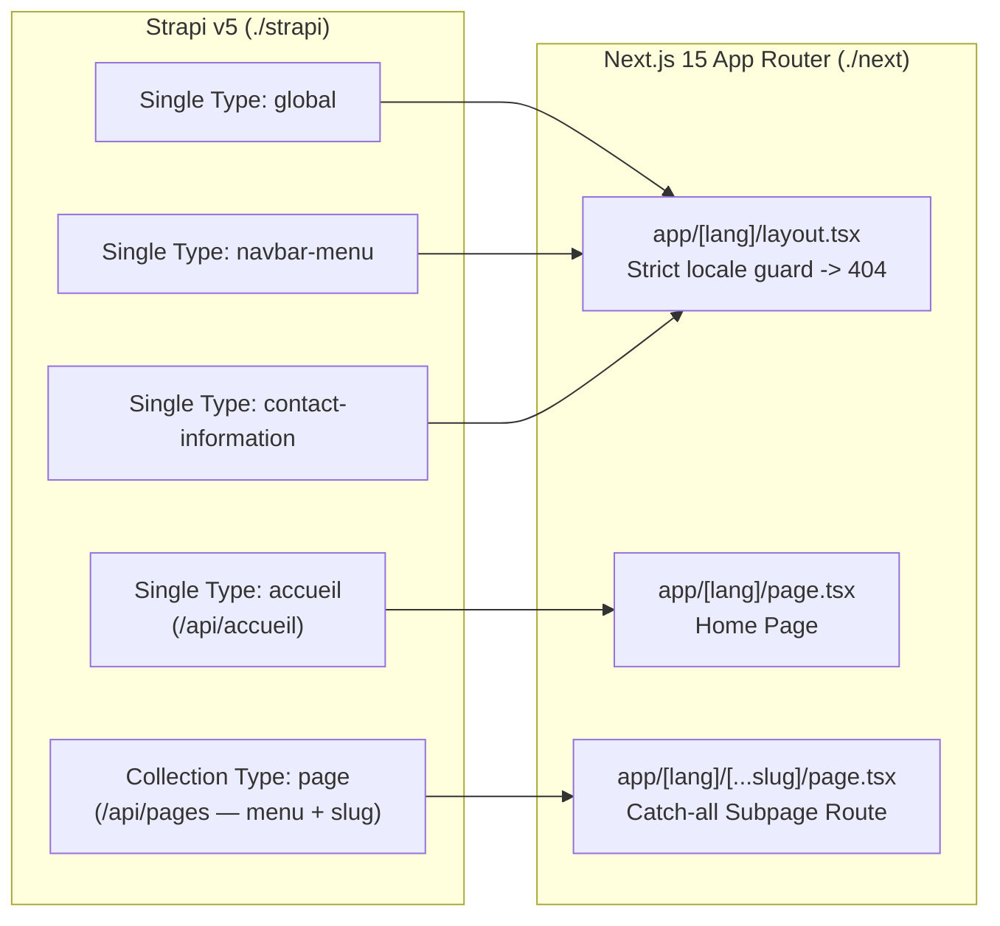

# Dynamic App Routing & Strapi `Page` Collection Type Refactoring

**Branch:** `refactor/dynamic-routing` (targeting `dev`)  
**Scope:** Issue 1 — Replace hardcoded subpage routes and Strapi Single Types with a dynamic Next.js catch-all route backed by a unified Strapi v5 `Page` Collection Type.

---

## 1. Overview & Motivation

Previously, adding or renaming a subpage required code changes in both applications:

1. **10 separate Strapi Single Types** (`student`, `contact`, `j42l`, `member`, `web-service`, `prototype-service`, `automation-service`, `impressum`, `privacy-policy`, `terms-of-service`), several with mismatched API vs. URL slugs (e.g. `/about/members` querying `/api/member`, `/services/web` querying `/api/web-service`).
2. **10 hardcoded Next.js `page.tsx` files** under `next/src/app/[lang]/`, each duplicating Strapi `populate` queries (some missing deep population on nested components) and omitting `locale` when calling `blockRenderer` (causing `ContactSection` to default to `"fr"`).
3. **Routing & middleware bugs**:
   - `next/src/middleware.ts` matched `blockedRoutes` (`services`, `legals`) without checking URL segment depth, inadvertently redirecting `/en/services/web` and `/en/legals/impressum` back to `/en`.
   - `next/src/app/[lang]/layout.tsx` silently defaulted unknown `[lang]` segments (e.g. `/unknown`) to `"en"` instead of returning HTTP 404.
   - `next/next.config.ts` redirected `/about` to unlocalized `/about/j42l` and did not handle `/:lang/about`.

### Target Architecture

---

## 2. Key Architectural Decisions

1. **Home remains dedicated**:
   - `next/src/app/[lang]/page.tsx` continues to query the `accueil` Single Type (`/api/accueil`), updated to support all 12 `layout.*` Dynamic Zone components for full block parity with subpages.
2. **Unified `Page` Collection Type (`/api/pages`)**:
   - Replaces all 10 subpage Single Types while preserving non-page data Single Types (`global`, `navbar-menu`, `contact-information`).
   - Editors can create new top-level (`/<lang>/<slug>`) or nested (`/<lang>/<menu>/<slug>`) pages directly in Strapi Admin without code deployments.
3. **Shared `menu` + `slug` across locales (`localized: false`)**:
   - `menu` (optional string, e.g. `about`, `services`, `legals`, or `null` for top-level pages) and `slug` (required string, e.g. `members`, `web`, `student`) are shared across `en`, `fr`, and `de`.
   - Keeping route paths identical across locales (`/<lang>/about/members`) preserves client-side locale switching in `LanguageSwitcher.tsx` without extra API round-trips.
4. **Lifecycle-enforced `(menu, slug)` uniqueness instead of SQL `unique: true`**:
   - Strapi v5 stores multiple database rows per logical document (`document_id`) across locales and draft/published states. Setting `"unique": true` or `type: "uid"` at the SQL column level breaks localization creation and would prevent distinct sections from sharing a final slug (e.g. `/about/faq` and `/services/faq`).
   - Instead, `strapi/src/api/page/content-types/page/lifecycles.ts` normalizes `menu` and `slug` (trimming whitespace/slashes, lowercasing, converting empty `menu` to `null`) and rejects duplicate `(menu, slug)` pairs only when they belong to a **different** `documentId`.

---

## 3. Summary of Changes

### 3.1 Strapi Backend (`./strapi`)

* **Added `Page` Collection Type (`api::page.page`)**:
  - `strapi/src/api/page/content-types/page/schema.json`: Localized collection type with `draftAndPublish: true`, localized `title` (required), non-localized `menu` (optional, regex-validated) and `slug` (required, regex-validated), optional localized `metaTitle` and `metaDescription`, and localized `blocks` Dynamic Zone with all 12 `layout.*` components.
  - `strapi/src/api/page/content-types/page/lifecycles.ts`: `beforeCreate` and `beforeUpdate` hooks normalizing `menu`/`slug` and enforcing `(menu, slug)` route uniqueness across distinct `documentId`s.
  - `strapi/src/api/page/controllers/page.ts`, `routes/page.ts`, `services/page.ts`: Core Strapi v5 factory boilerplate.
* **Updated `accueil` Single Type**:
  - `strapi/src/api/accueil/content-types/accueil/schema.json`: Expanded `blocks.components` from 7 to all 12 `layout.*` components; set `required: false` and removed `unique: true` on `metaTitle` and `metaDescription`.
* **Removed 10 obsolete subpage Single Types**:
  - Deleted `strapi/src/api/{automation-service,contact,impressum,j42l,member,privacy-policy,prototype-service,student,terms-of-service,web-service}`.
  - Updated `strapi/types/generated/contentTypes.d.ts` to add `ApiPagePage`, update `ApiAccueilAccueil`, and remove deleted Single Type schemas.

### 3.2 Next.js Data Layer & Types (`./next/src/utils`)

* **`next/src/utils/type.tsx`**:
  - Exported `ALLOWED_LOCALES = ["en", "fr", "de"] as const` and `SlugPageParams = Promise<{ lang: Locale; slug: string[] }>`.
* **`next/src/utils/fetchStrapiData.tsx`**:
  - Exported `PAGE_BLOCKS_POPULATE` covering all 12 Dynamic Zone components, including deep multi-level population for:
    - `layout.member-section` (`title`, `members.photo`, `members.social` with `populate: "*"`)
    - `layout.card-section` (`title`, `cards.button`, `cards.backgroundImage` with `url`, `alternativeText`, `width`, `height`)
    - `layout.services` (`servicesTitle`, `servicesAccordions.image`, `triggerbg`, `ctaButton`)
    - `layout.partner-carousel-section` (`sectionTitle`, `partners` with `populate: "*"`)
  - Added `getStrapiPageBySlug(segments, locale)`:
    - Validates every URL segment against `/^[a-z0-9]+(?:-[a-z0-9]+)*$/` before hitting Strapi (immediately returning `NOT_FOUND` on malformed paths).
    - Maps 1-segment paths (`[slug]`) to `menu IS NULL OR menu = ""` + `slug = pageSlug`, and multi-segment paths (`[...menu, slug]`) to `menu = segments.slice(0, -1).join("/")` + `slug = pageSlug`.
    - Queries `/api/pages` with `PAGE_BLOCKS_POPULATE` and `pagination[pageSize]=1`, unwrapping `data[0]`.
  - Added `getStrapiPageMetadata(segments, locale)`:
    - Queries lightweight scalar fields (`title`, `metaTitle`, `metaDescription`) from `/api/pages` with humanized slug fallbacks when SEO fields are omitted or Strapi is unavailable.

### 3.3 Next.js App Router Pages (`./next/src/app/[lang]`)

* **Added `next/src/app/[lang]/[...slug]/page.tsx`**:
  - Validates `lang` against `ALLOWED_LOCALES` (`notFound()` if invalid).
  - Resolves subpage content via `getStrapiPageBySlug(slug, lang)` and calls `notFound()` when missing or when `blocks` is empty.
  - Passes `lang` to `blockRenderer(block, lang)` so `ContactSection` fetches localized contact details.
  - Implements `generateMetadata` backed by `getStrapiPageMetadata(slug, lang)`.
* **Updated `next/src/app/[lang]/page.tsx`**:
  - Replaced inline `getQueryHero` with `PAGE_BLOCKS_POPULATE`.
  - Passed `locale` to `blockRenderer(block, locale)` and enforced `ALLOWED_LOCALES` validation.
* **Deleted 10 hardcoded subpage route folders**:
  - Removed `next/src/app/[lang]/{about,contact,legals,services,student}`.

### 3.4 Guards, Middleware & Redirects

* **`next/src/app/[lang]/layout.tsx`**:
  - Replaced silent fallback (`locale = "en"`) with `notFound()` when `lang` is not in `ALLOWED_LOCALES`, ensuring unknown root paths (e.g. `/nonexistent`) return HTTP 404.
* **`next/src/middleware.ts`**:
  - Restricted `blockedRoutes` redirects strictly to bare parent paths (`segments.length === 1` when unlocalized, `segments.length === 2` when localized) so `/en/services` still redirects to `/en` while `/en/services/web` and `/en/legals/impressum` resolve normally.
  - Excluded static and metadata paths (`robots.txt`, `sitemap.xml`, `graphic`, `partners`, `stock_photo`) in `config.matcher`.
* **`next/next.config.ts`**:
  - Updated permanent redirects so `/about` -> `/en/about/j42l` and `/:lang(en|fr|de)/about` -> `/:lang/about/j42l`.

---

## 4. URL-to-Strapi Route Mapping Reference

| Public URL (`<lang>` in `en`, `fr`, `de`) | Next.js Route | Strapi Collection / Single Type | `menu` | `slug` |
| :--- | :--- | :--- | :--- | :--- |
| `/<lang>` | `app/[lang]/page.tsx` | Single Type: `accueil` (`/api/accueil`) | — | — |
| `/<lang>/student` | `app/[lang]/[...slug]/page.tsx` | Collection Type: `page` (`/api/pages`) | *(empty / `null`)* | `student` |
| `/<lang>/contact` | `app/[lang]/[...slug]/page.tsx` | Collection Type: `page` (`/api/pages`) | *(empty / `null`)* | `contact` |
| `/<lang>/about/j42l` | `app/[lang]/[...slug]/page.tsx` | Collection Type: `page` (`/api/pages`) | `about` | `j42l` |
| `/<lang>/about/members` | `app/[lang]/[...slug]/page.tsx` | Collection Type: `page` (`/api/pages`) | `about` | `members` |
| `/<lang>/services/web` | `app/[lang]/[...slug]/page.tsx` | Collection Type: `page` (`/api/pages`) | `services` | `web` |
| `/<lang>/services/prototype` | `app/[lang]/[...slug]/page.tsx` | Collection Type: `page` (`/api/pages`) | `services` | `prototype` |
| `/<lang>/services/automation` | `app/[lang]/[...slug]/page.tsx` | Collection Type: `page` (`/api/pages`) | `services` | `automation` |
| `/<lang>/legals/impressum` | `app/[lang]/[...slug]/page.tsx` | Collection Type: `page` (`/api/pages`) | `legals` | `impressum` |
| `/<lang>/legals/privacy-policy` | `app/[lang]/[...slug]/page.tsx` | Collection Type: `page` (`/api/pages`) | `legals` | `privacy-policy` |
| `/<lang>/legals/terms-of-service` | `app/[lang]/[...slug]/page.tsx` | Collection Type: `page` (`/api/pages`) | `legals` | `terms-of-service` |

---

## 5. Verification Performed

1. **Strapi TypeScript & Emit Validation**:
   - `npx tsc --noEmit` and full TypeScript emit compilation in `./strapi` passed with zero errors.
   - Behavioral assertions verified `lifecycles.ts` route normalization (trimming slashes/whitespace, lowercasing, blank `menu` -> `null`), multi-locale allowance on matching `documentId`, same-slug allowance across distinct `menu`s, and `ApplicationError` rejection on duplicate `(menu, slug)` across distinct `documentId`s.
2. **Next.js Typecheck, Lint & Production Build**:
   - `npx tsc --noEmit`, `npm run lint`, and `npm run build` in `./next` passed with zero errors or warnings, compiling `/[lang]` and `/[lang]/[...slug]`.
3. **File Tree Audit**:
   - Confirmed `next/src/app/[lang]/` contains only `layout.tsx`, `page.tsx`, and `[...slug]/page.tsx`.
   - Confirmed `strapi/src/api/` contains only `accueil`, `contact-information`, `global`, `navbar-menu`, and `page`.

---

## 6. Post-Deployment Checklist (Strapi Admin)

Because obsolete Single Types were removed directly without database migration scripts, complete these steps in Strapi Admin when deploying:

1. **Enable Public Permissions** (`Settings -> Users & Permissions Plugin -> Roles -> Public`):
   - Grant **`find`** and **`findOne`** on **`Page`** (`api::page.page`).
   - Confirm **`find`** remains enabled on `Accueil`, `Global`, `Navbar-menu`, and `Contact-information`.
2. **Recreate & Publish the 10 Subpages** in the `Page` Collection Type across `en`, `fr`, and `de` using the `menu` and `slug` values in Section 4.

---

## 7. Commit History (`refactor/dynamic-routing`)

1. `2ff0b47` — `feat(strapi): add page collection type and align accueil schema`
2. `1b328ed` — `refactor(strapi): remove obsolete subpage single types`
3. `7e3f492` — `refactor(next): replace hardcoded subpages with dynamic catch-all route`
4. `0c5ec1a` — `fix(next): enforce locale 404 guard, middleware exclusions, and about redirects`
